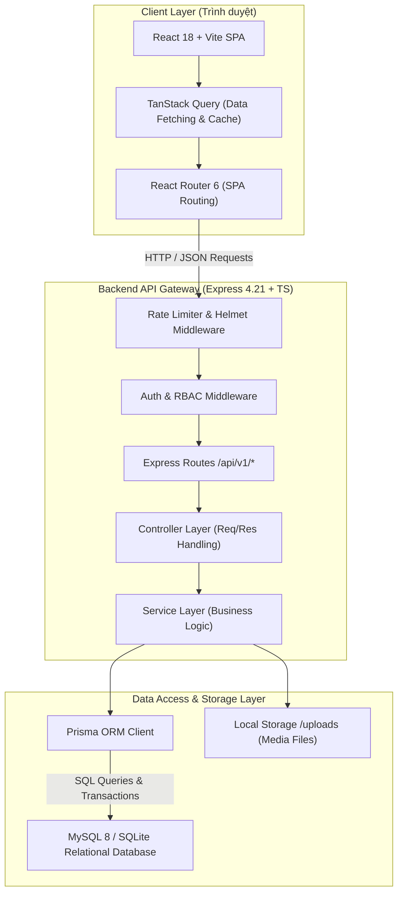
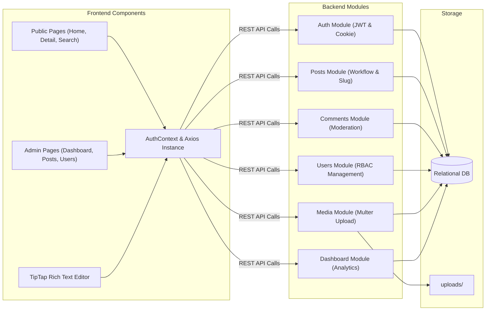
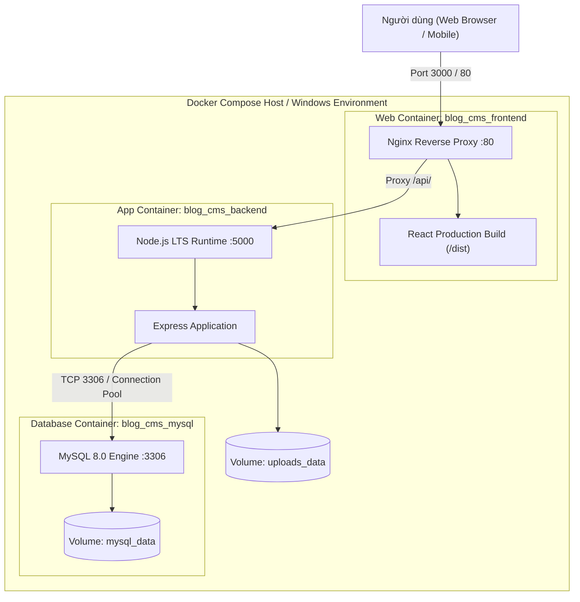
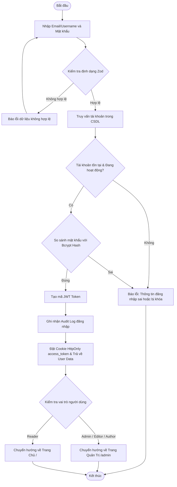
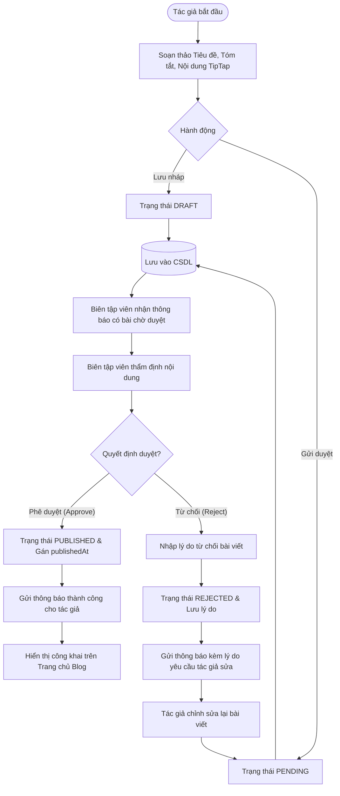
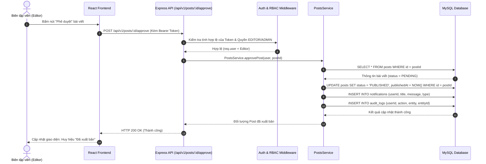
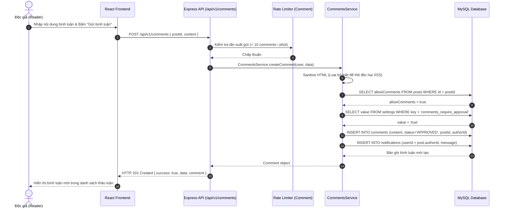

# KIẾN TRÚC HỆ THỐNG VÀ THIẾT KẾ KỸ THUẬT (ARCHITECTURE)
## HỆ THỐNG BLOG / CONTENT MANAGEMENT SYSTEM (CMS)

- **Dự án:** Hệ thống Blog / Content Management System (CMS) chuyên nghiệp.
- **Sinh viên thực hiện:** Vũ Trọng Nghĩa — Lớp: CNTT K23L.
- **Đơn vị:** Trường Đại học Công nghệ Thông tin và Truyền thông – Đại học Thái Nguyên (ICTU).
- **Giảng viên hướng dẫn:** ThS. Vũ Văn Diện.

---

## 1. MÔ HÌNH KIẾN TRÚC PHÂN TẦNG (LAYERED ARCHITECTURE)

Hệ thống được thiết kế theo kiến trúc 3 tầng chuẩn mực (Three-Tier Architecture), phân tách triệt để giữa Giao diện người dùng (Frontend), Tầng xử lý nghiệp vụ & API (Backend), và Tầng lưu trữ dữ liệu (Database Layer).



---

## 2. BIỂU ĐỒ THÀNH PHẦN (COMPONENT DIAGRAM)



---

## 3. BIỂU ĐỒ TRIỂN KHAI (DEPLOYMENT DIAGRAM)



---

## 4. QUY TRÌNH NGHIỆP VỤ & SƠ ĐỒ HOẠT ĐỘNG (ACTIVITY DIAGRAMS)

### 4.1. Sơ đồ hoạt động: Đăng nhập hệ thống (Login Activity Diagram)



### 4.2. Sơ đồ hoạt động: Vòng đời Tạo, Duyệt và Xuất bản bài viết



---

## 5. SƠ ĐỒ TUẦN TỰ (SEQUENCE DIAGRAMS)

### 5.1. Sequence Diagram: Phê duyệt bài viết (Approve Post)



### 5.2. Sequence Diagram: Độc giả gửi bình luận (Post Comment)



---

## 6. KIẾN TRÚC GIÁM SÁT HỆ THỐNG & DEVOPS (OBSERVABILITY & MONITORING)

Nhằm đáp ứng yêu cầu môn học **Triển khai và hệ thống phần mềm**, hệ thống được tích hợp bộ công cụ giám sát hiệu năng hoàn chỉnh bao gồm **Prometheus** và **Grafana**:

```mermaid
flowchart LR
    subgraph AppServer ["Máy chủ Ứng dụng Backend (Node.js)"]
        ExpressApp["Express.js App (:5000)"]
        PromClient["prom-client Collector"]
        MetricsEndpoint["/api/v1/metrics (:5000)"]
        ExpressApp -->|HTTP Events & Latency| PromClient
        PromClient -->|Export Metrics| MetricsEndpoint
    end

    subgraph MonitorServer ["Hệ thống Giám sát & Đo đạc"]
        Prometheus["Prometheus Server (:9090)<br/>Scrape Interval: 5s"]
        Grafana["Grafana Visualization (:3001)<br/>Dashboard Auto-Provisioned"]
        MetricsEndpoint -->|Scrape (Pull)| Prometheus
        Prometheus -->|PromQL Queries| Grafana
    end

    subgraph ClientOps ["Người vận hành / Quản trị viên"]
        AdminUser["Quản trị viên / Giảng viên"]
        Grafana -->|Trực quan hóa đồ thị thời gian thực| AdminUser
    end
```

### Các chỉ số được thu thập và giám sát:
1. **Chỉ số lưu lượng (Traffic Metrics):**
   - `blog_cms_http_requests_total`: Đếm tổng số lượt request phân nhóm theo HTTP method, route và status code (2xx, 4xx, 5xx).
   - Tốc độ xử lý yêu cầu tức thời (Requests Per Second - RPS).
2. **Chỉ số độ trễ (Latency Metrics):**
   - `blog_cms_http_request_duration_seconds`: Histogram đo đạc thời gian đáp ứng API, phân tích theo phân vị p50, p90, p95 và p99.
3. **Chỉ số tài nguyên máy chủ (System Runtime Metrics):**
   - Bộ nhớ RAM tiêu thụ của Node.js: `blog_cms_nodejs_heap_size_used_bytes` và `blog_cms_nodejs_heap_size_total_bytes`.
   - Mức chiếm dụng CPU: `blog_cms_process_cpu_user_seconds_total`.
   - Thời gian hoạt động liên tục (Uptime): `blog_cms_process_uptime_seconds`.
