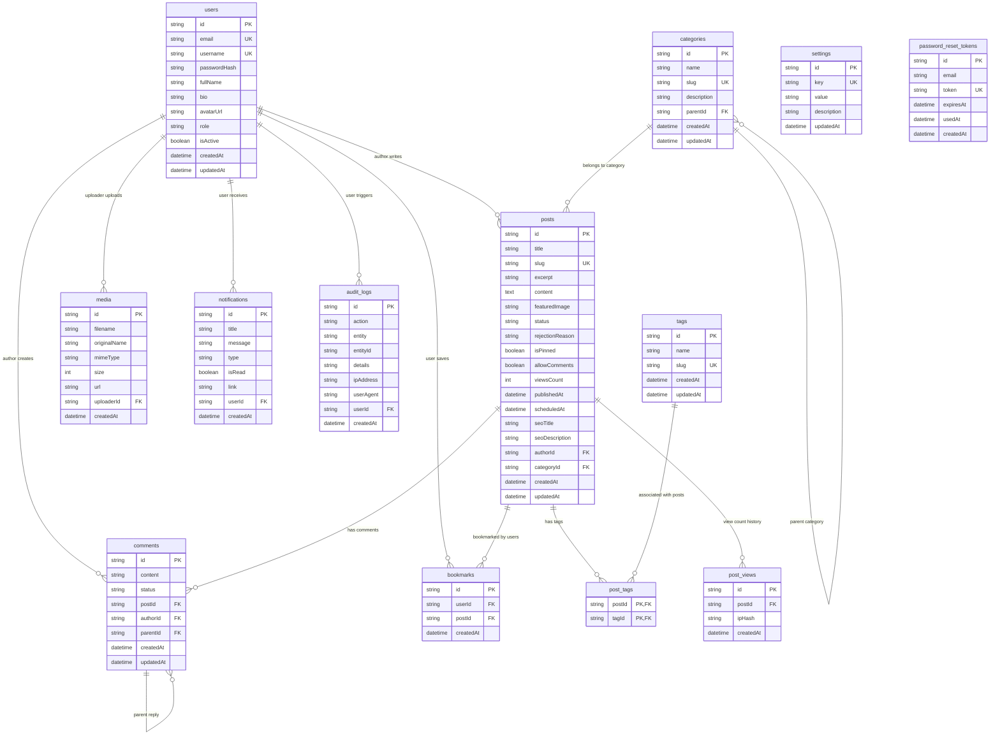

# THIẾT KẾ CƠ SỞ DỮ LIỆU QUAN HỆ (DATABASE)
## HỆ THỐNG BLOG / CONTENT MANAGEMENT SYSTEM (CMS)

- **Dự án:** Hệ thống Blog / Content Management System (CMS) chuyên nghiệp.
- **Sinh viên thực hiện:** Vũ Trọng Nghĩa — Lớp: CNTT K23L.
- **Đơn vị:** Trường Đại học Công nghệ Thông tin và Truyền thông – Đại học Thái Nguyên (ICTU).
- **Giảng viên hướng dẫn:** ThS. Vũ Văn Diện.
- **Hệ quản trị CSDL mục tiêu:** MySQL 8.0 (kết hợp Prisma ORM Migration & SQLite dev mode).

---

## 1. SƠ ĐỒ THỰC THỂ QUAN HỆ (ERD - ENTITY RELATIONSHIP DIAGRAM)



---

## 2. TỪ ĐIỂN DỮ LIỆU CHI TIẾT (DATA DICTIONARY)

### 2.1. Bảng `users` (Người dùng hệ thống)
Lưu trữ thông tin tài khoản người dùng, phân quyền RBAC và trạng thái hoạt động.

| Tên cột | Kiểu dữ liệu (MySQL) | Ràng buộc | Ý nghĩa |
|---|---|---|---|
| `id` | `VARCHAR(36)` | PK | Khóa chính (UUID v4) |
| `email` | `VARCHAR(191)` | UNIQUE, NOT NULL | Địa chỉ email đăng nhập |
| `username` | `VARCHAR(191)` | UNIQUE, NOT NULL | Tên định danh người dùng |
| `passwordHash` | `VARCHAR(255)` | NOT NULL | Mật khẩu mã hóa Bcrypt 10 rounds |
| `fullName` | `VARCHAR(191)` | NOT NULL | Họ và tên hiển thị |
| `bio` | `TEXT` | NULL | Tiểu sử tác giả / độc giả |
| `avatarUrl` | `VARCHAR(500)` | NULL | Đường dẫn ảnh đại diện |
| `role` | `VARCHAR(50)` | NOT NULL, DEFAULT 'READER' | Vai trò (`ADMIN`, `EDITOR`, `AUTHOR`, `READER`) |
| `isActive` | `BOOLEAN` | DEFAULT TRUE | Trạng thái tài khoản (True = Hoạt động, False = Khóa) |
| `createdAt` | `DATETIME` | DEFAULT CURRENT_TIMESTAMP | Thời gian tạo tài khoản |
| `updatedAt` | `DATETIME` | ON UPDATE CURRENT_TIMESTAMP | Thời gian cập nhật gần nhất |

### 2.2. Bảng `categories` (Chuyên mục bài viết)
Quản lý cây danh mục phân cấp bài viết.

| Tên cột | Kiểu dữ liệu (MySQL) | Ràng buộc | Ý nghĩa |
|---|---|---|---|
| `id` | `VARCHAR(36)` | PK | Khóa chính (UUID v4) |
| `name` | `VARCHAR(191)` | NOT NULL | Tên chuyên mục |
| `slug` | `VARCHAR(191)` | UNIQUE, NOT NULL | Đường dẫn SEO thân thiện |
| `description` | `TEXT` | NULL | Mô tả chi tiết chuyên mục |
| `parentId` | `VARCHAR(36)` | FK -> `categories(id)`, ON DELETE SET NULL | Danh mục cha (nếu có) |
| `createdAt` | `DATETIME` | DEFAULT CURRENT_TIMESTAMP | Ngày tạo |
| `updatedAt` | `DATETIME` | ON UPDATE CURRENT_TIMESTAMP | Ngày cập nhật |

### 2.3. Bảng `posts` (Bài viết nội dung)
Bảng cốt lõi quản lý thông tin bài viết và vòng đời trạng thái xuất bản.

| Tên cột | Kiểu dữ liệu (MySQL) | Ràng buộc | Ý nghĩa |
|---|---|---|---|
| `id` | `VARCHAR(36)` | PK | Khóa chính |
| `title` | `VARCHAR(255)` | NOT NULL | Tiêu đề bài viết |
| `slug` | `VARCHAR(255)` | UNIQUE, NOT NULL | Slug bài viết duy nhất |
| `excerpt` | `TEXT` | NULL | Tóm tắt ngắn mở đầu |
| `content` | `LONGTEXT` | NOT NULL | Nội dung định dạng HTML đã làm sạch (Sanitized) |
| `featuredImage` | `VARCHAR(500)` | NULL | Ảnh đại diện bài viết |
| `status` | `VARCHAR(50)` | DEFAULT 'DRAFT' | Trạng thái (`DRAFT`, `PENDING`, `PUBLISHED`, `REJECTED`, `SCHEDULED`, `ARCHIVED`) |
| `rejectionReason` | `TEXT` | NULL | Lý do từ chối phê duyệt từ Biên tập viên |
| `isPinned` | `BOOLEAN` | DEFAULT FALSE | Trạng thái ghim đầu trang |
| `allowComments` | `BOOLEAN` | DEFAULT TRUE | Cho phép độc giả bình luận |
| `viewsCount` | `INT` | DEFAULT 0 | Tổng số lượt xem |
| `publishedAt` | `DATETIME` | NULL | Thời gian xuất bản chính thức |
| `scheduledAt` | `DATETIME` | NULL | Thời gian lên lịch xuất bản |
| `seoTitle` | `VARCHAR(255)` | NULL | Tiêu đề tối ưu hóa công cụ tìm kiếm |
| `seoDescription` | `VARCHAR(500)` | NULL | Mô tả thẻ Meta Description |
| `authorId` | `VARCHAR(36)` | FK -> `users(id)`, ON DELETE CASCADE | Tác giả bài viết |
| `categoryId` | `VARCHAR(36)` | FK -> `categories(id)`, ON DELETE SET NULL | Chuyên mục liên kết |
| `createdAt` | `DATETIME` | DEFAULT CURRENT_TIMESTAMP | Thời gian tạo |
| `updatedAt` | `DATETIME` | ON UPDATE CURRENT_TIMESTAMP | Thời gian sửa gần nhất |

### 2.4. Bảng `post_tags` (Bảng trung gian Bài viết - Thẻ)
Mô hình hóa quan hệ Nhiều - Nhiều ($N - N$) giữa `posts` và `tags`.

| Tên cột | Kiểu dữ liệu | Ràng buộc | Ý nghĩa |
|---|---|---|---|
| `postId` | `VARCHAR(36)` | PK, FK -> `posts(id)`, ON DELETE CASCADE | Mã bài viết |
| `tagId` | `VARCHAR(36)` | PK, FK -> `tags(id)`, ON DELETE CASCADE | Mã thẻ |

### 2.5. Bảng `comments` (Bình luận & Phản hồi)
Lưu trữ thảo luận phân cấp của độc giả.

| Tên cột | Kiểu dữ liệu | Ràng buộc | Ý nghĩa |
|---|---|---|---|
| `id` | `VARCHAR(36)` | PK | Khóa chính |
| `content` | `TEXT` | NOT NULL | Nội dung bình luận thuần văn bản |
| `status` | `VARCHAR(50)` | DEFAULT 'APPROVED' | Trạng thái (`PENDING`, `APPROVED`, `REJECTED`, `SPAM`) |
| `postId` | `VARCHAR(36)` | FK -> `posts(id)`, ON DELETE CASCADE | Bài viết được bình luận |
| `authorId` | `VARCHAR(36)` | FK -> `users(id)`, ON DELETE CASCADE | Người bình luận |
| `parentId` | `VARCHAR(36)` | FK -> `comments(id)`, ON DELETE CASCADE | Bình luận cha (nếu là câu trả lời) |
| `createdAt` | `DATETIME` | DEFAULT CURRENT_TIMESTAMP | Thời gian gửi |

---

## 3. CHIẾN LƯỢC LẬP CHỈ MỤC (INDEXING STRATEGY)

Để tối ưu hóa tốc độ truy vấn đối với các bảng có dung lượng lớn, hệ thống thiết lập các chỉ mục (Indexes) theo tiêu chuẩn B-Tree:
- **Chỉ mục duy nhất (Unique Indexes):**
  - `users(email)` và `users(username)`: Đảm bảo không trùng lặp tài khoản.
  - `posts(slug)` và `categories(slug)` và `tags(slug)`: Tối ưu hóa truy vấn chi tiết bài viết qua URL.
  - `bookmarks(userId, postId)`: Ngăn chặn một độc giả lưu một bài viết nhiều lần.
- **Chỉ mục kết hợp và truy vấn thường xuyên (Composite & Single Indexes):**
  - `posts(status, publishedAt)`: Tối ưu hóa truy vấn danh sách bài viết trang chủ và phân trang.
  - `posts(authorId)` và `posts(categoryId)`: Tăng tốc lọc bài viết theo tác giả và chuyên mục.
  - `comments(postId, status)`: Tối ưu truy vấn danh sách bình luận đã duyệt của bài viết.
  - `audit_logs(createdAt, entity)`: Hỗ trợ truy vấn lịch sử hoạt động nhanh chóng.

---

## 4. QUY TRÌNH MIGRATION & SEEDING

1. **Sinh cấu trúc Prisma Client:**
   ```bash
   npx prisma generate
   ```
2. **Đồng bộ Schema vào CSDL:**
   ```bash
   npx prisma db push
   ```
3. **Nạp dữ liệu mẫu hoàn chỉnh (Seeding):**
   ```bash
   npm run db:seed
   ```

---

## 5. HƯỚNG DẪN SAO LƯU VÀ PHỤC HỒI (BACKUP & RESTORE)

### 5.1. Sao lưu CSDL MySQL (Backup)
```bash
# Thực hiện sao lưu ra tệp SQL Dump
mysqldump -h localhost -P 3306 -u root -p blog_cms > backup_blog_cms.sql
```

### 5.2. Phục hồi CSDL MySQL (Restore)
```bash
# Khôi phục dữ liệu từ tệp SQL Dump
mysql -h localhost -P 3306 -u root -p blog_cms < backup_blog_cms.sql
```
